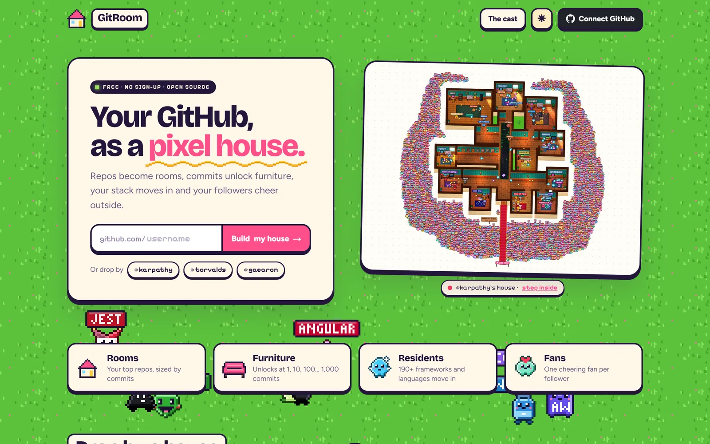
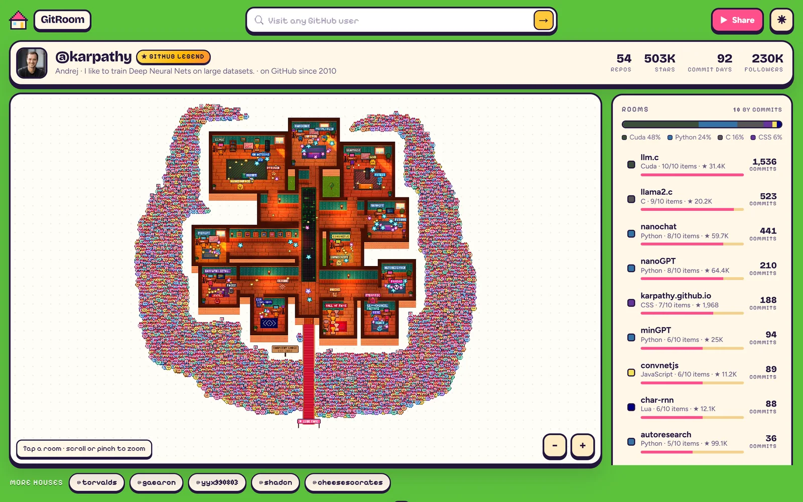
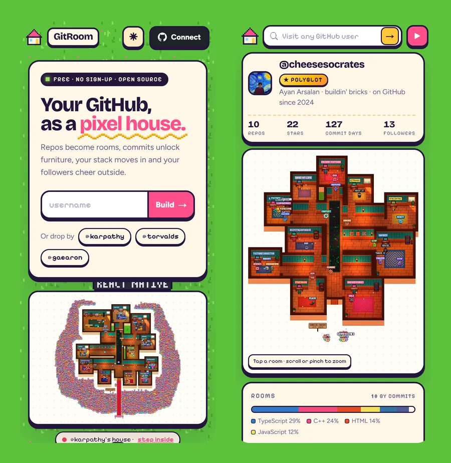
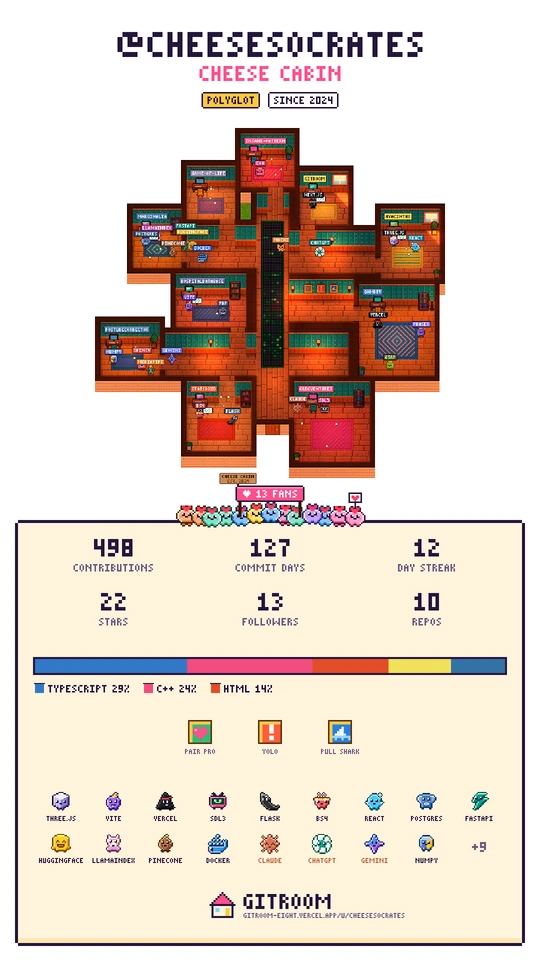
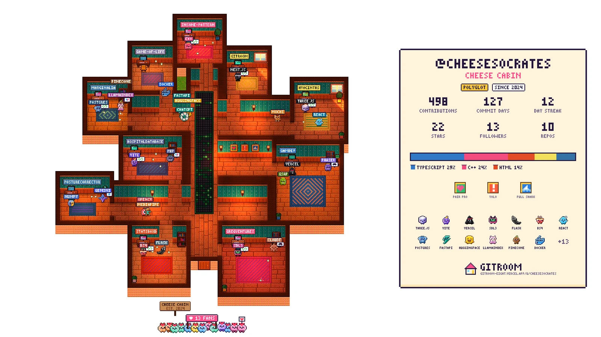
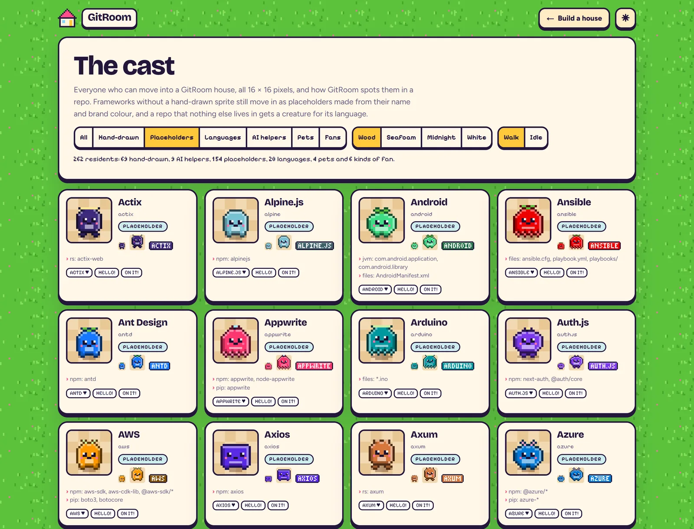

<div align="center">

# 🏠 GitRoom

**Your GitHub, as a pixel house.**

Type any GitHub username and watch it turn into a cosy pixel-art house: repos become rooms, commits unlock furniture, your stack moves in and your followers cheer outside.

### [**→ Open GitRoom**](https://gitroom-eight.vercel.app)

[@karpathy](https://gitroom-eight.vercel.app/u/karpathy) · [@torvalds](https://gitroom-eight.vercel.app/u/torvalds) · [@gaearon](https://gitroom-eight.vercel.app/u/gaearon) · [@cheesesocrates](https://gitroom-eight.vercel.app/u/cheesesocrates)

Free · no sign-up · no API keys · MIT



</div>

## What you get



- **Rooms.** Your busiest repos each get a room, sized by commits.
- **Furniture.** Every room unlocks something new at 1, 2, 5, 10, 25, 50, 100, 200, 500 and 1,000 commits: rug, desk, bookshelf, plant, lamp, TV, couch, arcade, trophy.
- **Residents.** Your stack moves in. GitRoom reads `package.json`, `requirements.txt`, `pyproject.toml`, `go.mod`, `Cargo.toml` and friends, and spots **190+ frameworks, tools and languages**. About 70 have hand-drawn sprites; the rest get a placeholder resident made from their name and brand colour, so nobody is left out.
- **AI helpers.** Claude, ChatGPT, Gemini, Copilot and Cursor drop by when your repos use them (or keep a `CLAUDE.md`, `AGENTS.md`, `GEMINI.md`…). They roam every room.
- **Fans.** One cheering fan per follower, up to 3,000 on the lawn, with a red carpet and a banner showing the real number.
- **Extras.** A contribution-graph rug, stars floating around the rooms that earned them, your achievement badges framed in the hallway, and bonus rooms (Hall of Fame, Observatory, Fan Lounge…) for small or legendary accounts.

<table>
<tr>
<td width="62%"></td>
<td></td>
</tr>
<tr>
<td>Works great on phones: pinch to zoom, tap a room or a resident.</td>
<td>Share a story, square or wide image, or a 15-second MP4.</td>
</tr>
</table>

## Share your house

Press **Share** on any house to make a picture (story 9:16, square, or a 2560 × 1440 wallpaper) or a **15-second video** of the house in motion. Videos are rendered frame by frame with WebCodecs, so they're ready in seconds, and saved as MP4. Every house link also gets its own social preview card.



## Make it yours (no password, no OAuth)

Visitors can only look around. To change your own house, press **Connect GitHub** and commit one small file to your profile repo (`<you>/<you>/.gitroom/…json`). GitRoom opens GitHub's own "new file" page with it already filled in; you press **Commit changes**.

Only you can push to your profile repo, so GitHub itself proves the house is yours. GitRoom never asks for a password or a token and never writes to your account. Once connected, you can:

- pick which repos get rooms, and turn bonus rooms on or off
- remove residents the detector got wrong, or add missing ones
- shuffle the floor plan until you like it
- rename the house, and pick the wallpaper, pet and lighting

Edits show up instantly in your browser. **Publish** commits a new house file, and every visitor sees it within a minute.

## How it works: zero keys

GitRoom runs without a single API key, token, OAuth app or database:

1. **Three API calls per house.** The user, their repos and their house file come from GitHub's public REST API, which needs no token.
2. **Public pages for the rest.** Commit counts and file lists come from each repo's public web page, and manifests from `raw.githubusercontent.com`. The contribution graph and badges come from the public profile. None of these touch the API quota.
3. **Cached at the edge.** The server builds each house and Vercel's CDN keeps it for six hours, so a popular house costs GitHub one read.
4. **Graceful fallback.** If the server has used up GitHub's free quota, your browser makes those three calls itself. Featured houses ship as snapshots, and rate limits show a friendly "try again in N minutes".

## Run it yourself

```bash
git clone https://github.com/cheesesocrates/gitroom
cd gitroom
npm install
npm run dev        # http://localhost:3000
```

There are no environment variables to set. To deploy, import the repo on [Vercel](https://vercel.com/new) and press Deploy.

## Under the hood

| Path | What it does |
| --- | --- |
| `lib/github-rest.js` | Reads a person from GitHub's public API (works on the server and in the browser) |
| `lib/repo-page.js` | Commit counts and files from public repo pages |
| `lib/page.js` | Contribution calendar and achievements from the public profile |
| `lib/detect.js` | Which resident moves in for which dependency or file (190+ rules) |
| `lib/analyze.js` | Turns GitHub data into the house profile |
| `lib/settings.js` | The house file format, checked strictly (it comes from someone else's repo) |
| `lib/client.js` | Browser side: caching, fallbacks, connect and publish |
| `app/api/*` | `house`, `repos`, `page` and `settings` routes, all CDN-cached |
| `public/engine/` | The pixel engine: sprites, floor plans, furniture, a WebGL lighting shader, share images and video |

Built with Next.js 16, plain canvas and WebGL, GSAP for motion and Mediabunny for MP4 encoding.



## Credits

- [GSAP](https://gsap.com) 3.12.5 (`public/vendor/gsap.min.js`), under GreenSock's standard license.
- [Mediabunny](https://mediabunny.dev) 1.61.4 (`public/vendor/mediabunny.min.mjs`), MPL-2.0, license alongside it.
- [Tiny5](https://github.com/Gissio/font_tiny5) digits (`public/fonts/`), SIL OFL 1.1.
- Bricolage Grotesque, Figtree and Pixelify Sans (Google Fonts, and as WOFF files in `assets/fonts/` for the social cards), all SIL OFL 1.1.
- GitRoom isn't affiliated with GitHub. It only reads public data.

## License

MIT, see [`LICENSE`](LICENSE). The vendored libraries and fonts keep their own licenses.
